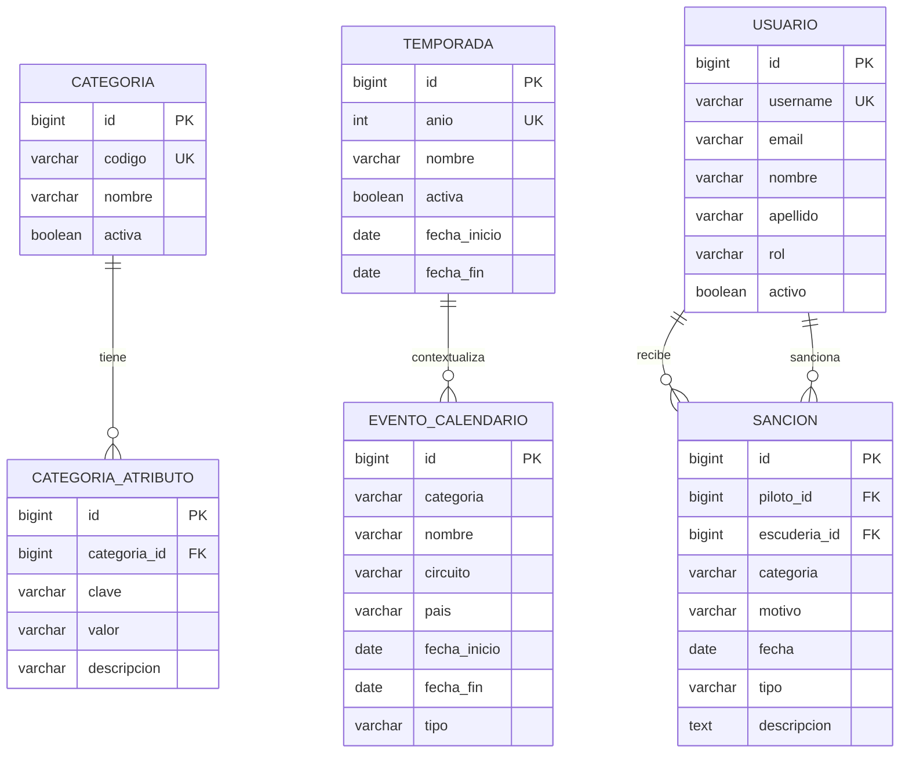

# Historia 1 – Vista consolidada de información

## 1) ER de referencia

## 2) Justificación del diseño de atributos clave/valor

La vista consolidada no intenta duplicar la lógica del negocio ni convertir cada dimensión en columnas fijas. En cambio, usa una tabla de referencia `categoria_atributo` con la forma:

- `categoria_id`
- `clave`
- `valor`
- `descripcion`

Esto resuelve dos problemas importantes:

1. La estructura se adapta a categorías distintas sin generar cambios de esquema ad hoc. Por ejemplo, una categoría puede tener una clave `tipo_competencia`, otra puede necesitar `formato` o `cant_pilotos`, y cada valor se almacena sin reescribir la entidad.
2. El dashboard puede mostrar una lista de atributos clave/valor para cada categoría, manteniendo la exposición de contexto operativo sin acoplar la presentación a columnas rígidas.

La clave del diseño es que `categoria` sigue siendo una entidad de catálogo de referencia, mientras que la lista de atributos describe el contexto operativo de una categoría concreta. Así el backend puede responder en una estructura genérica con `codigo`, `nombre`, `temporadaActual`, `eventosCalendario`, `sanciones`, `pruebasNeumaticos`, y una colección `atributos`.

## 3) Deuda técnica identificada

### Enum `Categoria` vs tabla `categoria`

El proyecto ya tenía un enum `Categoria` en Java (`F1`, `F2`, `F3`, `F1_ACADEMY`) para persistir valores en tablas existentes como `evento_calendario` y `sancion`. Ese enum es útil y compatible con los modelos previos, pero no reemplaza a un catálogo de negocio real. La nueva tabla `categoria` se agregó para habilitar la referencia maestra del dashboard y la capas de metadatos por categoría.

El punto crítico es que hoy coexisten dos representaciones conceptualmente distintas:

- `enum Categoria`: forma de codificar el dominio legacy y los registros ya existentes.
- `tabla categoria`: catálogo de referencia para la nueva vista consolidada y para futuros atributos por categoría.

Esto es una deuda técnica asumida intencionalmente para no romper compatibilidad con el esquema actual y permitir la migración gradual.

### `sancion.escuderia_id` apuntando a `usuario`

La entidad `Sancion` tiene un campo `escuderia_id` que hoy apunta a `usuario`. Eso funciona para el modelo actual de la app, pero semánticamente es ambiguo: la escudería no es necesariamente un usuario de la plataforma, y su relación está mezclando la identidad del negocio con la identidad de acceso. Este diseño obliga a la capa de negocio a interpretar el rol del usuario para inferir la escudería y complica la evolución futura hacia una entidad `Escuderia` real con relación 1:N.

Es una deuda técnica de modelado que no se resuelve en la Historia 1 para no expandir el alcance del sprint, pero sí debe quedar documentada como punto de evolución del dominio.

## 4) Estado actual del diseño

- La data de referencia de categorías y temporada vive SOLO en la migración de Flyway V3.
- `DataInitializer` queda reservado para usuarios demo y roles de seguridad, sin duplicar la base de categorías ni temporadas.
- La vista consolidada consume esa estructura para responder el dashboard de `ADMIN_FIA` con filtros por categoría y temporada.
